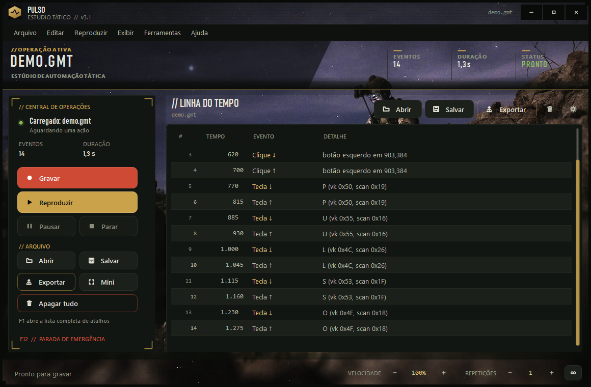

<div align="center">


# Pulso

**Estúdio de automação para Windows. Grave, edite, reproduza e compile macros.**

[](#requisitos)
[](#requisitos)
[](#requisitos)
[](LICENSE)

[Download](#download) · [Recursos](#recursos) · [Atalhos](#atalhos) · [Formatos](#formatos-de-arquivo) · [Compilar](#compilar-do-c%C3%B3digo-fonte) · [FAQ](docs/faq.md)



</div>

---

**Pulso** é um gravador e reprodutor de macros para Windows — uma evolução do conceito do TinyTask, com interface moderna, linha do tempo editável, atalhos globais configuráveis, presets de reprodução e compilação da macro em um `.exe` autônomo.

Grava mouse e teclado por **hooks de baixo nível** (eventos reais, sem perder cliques), reproduz com controle total de velocidade, repetições, atrasos e janela de destino, e ainda importa/exporta o formato `.rec` do TinyTask.

## Download

A versão pronta fica na página de **[Releases](../../releases/latest)**.

| Edição | Arquivo | Tamanho | Requisito |
|---|---|---|---|
| Portátil | `Pulso.exe` | ~430 KB | [.NET 8 Desktop Runtime](https://dotnet.microsoft.com/download/dotnet/8.0) |
| Autocontida | `Pulso-selfcontained.exe` | ~70 MB | Nenhum — só Windows x64 |

> Não sabe qual escolher? Se o `Pulso.exe` não abrir, use a edição **autocontida**.
> Cada release publica também o `SHA256SUMS.txt` para conferência de integridade.

**Verificar o hash (PowerShell):**

```powershell
Get-FileHash .\Pulso.exe -Algorithm SHA256
```

## Requisitos

- Windows 10 ou Windows 11, x64
- .NET 8 Desktop Runtime (apenas na edição portátil)
- Para compilar do código-fonte: [.NET SDK 8](https://dotnet.microsoft.com/download/dotnet/8.0) e Windows

## Recursos

### Gravação
- Captura global de **mouse e teclado** via `SetWindowsHookEx` (eventos reais, timestamps em ms)
- Gravação de movimento, cliques, roda e botões laterais (X1/X2)
- Teclas por **scan code** ou virtual key (melhor compatibilidade com jogos)
- Ignora cliques dentro da própria janela do Pulso
- Registra a janela de destino (handle + posição) para reproduzir no mesmo lugar
- Atalho global para iniciar/parar a gravação

### Reprodução
- Velocidade de **5% a 2000%**
- Repetições de **1 a 100.000** ou modo **contínuo**
- Atraso entre ciclos e atraso inicial configuráveis
- Modo **instantâneo** (sem intervalos)
- Pausa/retomada em qualquer ponto
- Reprodução **relativa à janela gravada**
- Envio de teclas direto à janela de destino (`PostMessage`)
- **F12** interrompe tudo, sempre — emergência global
- Player dedicado ao abrir uma macro compilada

### Edição
- Linha do tempo com colunas de tempo, evento e detalhe
- Editar evento individual, remover selecionados, limpar tudo
- Inserir pausa a partir de um ponto
- Ajustar escala de tempo da macro inteira
- Remover espera inicial
- Arrastar e soltar arquivos `.gmt`, `.pulso`, `.rec` e `.json` na janela

### Interface
- Tema escuro, HUD compacto e barra mini
- Sempre no topo (opcional), bandeja do sistema, tela cheia
- Persistência portátil: configuração e log ao lado do executável
  (ou em `%APPDATA%\Pulso` quando a pasta não é gravável)
- Testes internos (`--selftest`) e smoke test de UI (`--smoke`)

## Atalhos

Atalhos globais (funcionam com o Pulso em segundo plano) — todos configuráveis em **Ferramentas → Configurações**:

| Ação | Padrão |
|---|---|
| Gravar / parar gravação | `Ctrl+Alt+R` |
| Reproduzir | `Ctrl+Alt+P` |
| Pausar / continuar | `Ctrl+Alt+Espaço` |
| Parar tudo | `Ctrl+Alt+S` |
| Modo compacto | `Ctrl+Alt+M` |
| **Parada de emergência** | **F12** (sempre ativa) |

Atalhos locais da janela:

| Ação | Tecla |
|---|---|
| Gravar / parar | `F9` |
| Reproduzir | `F5` |
| Nova macro | `Ctrl+N` |
| Abrir | `Ctrl+O` |
| Salvar | `Ctrl+S` |
| Salvar como | `Ctrl+Shift+S` |
| Exportar macro pronta (`.pulso`) | `Ctrl+E` |
| Configurações | `Ctrl+,` |
| Tela cheia | `F11` |

## Início rápido

1. Baixe `Pulso.exe` e execute (não precisa instalar).
2. Aperte **`Ctrl+Alt+R`** e execute a sequência que deseja automatizar.
3. Aperte **`Ctrl+Alt+R`** de novo para encerrar a gravação.
4. Ajuste velocidade, repetições e atraso na barra inferior.
5. Aperte **`F5`** (ou `Ctrl+Alt+P`) para reproduzir.
6. Para compartilhar a automação configurada: **Arquivo → Exportar macro pronta…** (`.pulso`).
7. Para gerar um executável independente, use a CLI:

   ```powershell
   Pulso.exe --compile minha-macro.gmt minha-macro.exe
   ```

## Linha de comando

```text
Pulso.exe                          abre o estúdio
Pulso.exe --version                mostra a versão
Pulso.exe --help                   mostra a ajuda
Pulso.exe --selftest               executa os testes internos (selftest.txt)
Pulso.exe --smoke                  teste rápido de criação das janelas
Pulso.exe --demo <arquivo.gmt>     gera uma automação de demonstração
Pulso.exe --compile <in> <out.exe> compila uma macro em executável
Pulso.exe --play <arquivo>         reproduz uma macro sem abrir a interface
Pulso.exe <arquivo>                abre .gmt, .rec, .pulso ou .json direto
```

Códigos de saída: `0` sucesso · `1` falha · `2` uso incorreto.

Variável `PULSO_PROBE=1` grava um relatório de diagnóstico (`probe.txt`) — útil para inspecionar executáveis compilados.

## Formatos de arquivo

| Extensão | Papel | Descrição |
|---|---|---|
| `.gmt` | Macro nativa | JSON com metadados da tela e lista de eventos |
| `.pulso` | Macro pronta | Pacote com macro + preset de reprodução + nome/duração |
| `.rec` | Compatibilidade | Formato binário do TinyTask (importação e exportação) |
| `.exe` | Macro compilada | Cópia do Pulso com o JSON embutido em um trailer `PULSOTSK` |

Detalhes completos dos schemas em **[docs/formatos.md](docs/formatos.md)**.

## Compilar do código-fonte

```powershell
# Build de desenvolvimento
dotnet build src/Pulso/Pulso.csproj -c Release

# Publicar executável único portátil (~430 KB, requer .NET 8 Desktop Runtime)
dotnet publish src/Pulso/Pulso.csproj -c Release -r win-x64 `
  --self-contained false -p:PublishSingleFile=true -o dist

# Publicar edição autocontida (sem dependências, ~70 MB)
dotnet publish src/Pulso/Pulso.csproj -c Release -r win-x64 `
  --self-contained true -p:PublishSingleFile=true `
  -p:EnableCompressionInSingleFile=true -o dist/self-contained
```

Ou use o script pronto:

```powershell
.\scripts\build.ps1                 # portátil + testes
.\scripts\build.ps1 -SelfContained  # também gera a edição autocontida
```

Validação:

```powershell
.\dist\Pulso.exe --selftest   # 12 testes internos
.\dist\Pulso.exe --smoke      # criação das janelas
```

## Estrutura do projeto

```text
pulso/
├─ src/Pulso/            código-fonte C# (WinForms, .NET 8)
│  ├─ Program.cs         entrada, CLI, selftest, compilação de macro
│  ├─ MainForm.cs        estúdio: linha do tempo, HUD, menus, tray
│  ├─ InputEngine.cs     hooks globais de mouse/teclado
│  ├─ Player.cs          motor de reprodução em thread dedicada
│  ├─ Macro.cs           modelo, JSON, import/export .rec
│  ├─ SelfExe.cs         trailer PULSOTSK e clonagem do executável
│  ├─ Settings.cs        configurações e atalhos
│  └─ ...                UI, tema, P/Invoke e utilitários
├─ docs/                 uso, formatos, compilação, arquitetura e FAQ
├─ scripts/              build e publicação no GitHub
├─ examples/             macro de demonstração
├─ assets/               ícone e screenshot
└─ .github/workflows/    CI (build + release automática por tag)
```

Mais detalhes em **[docs/arquitetura.md](docs/arquitetura.md)**.

## Aviso de segurança

O Pulso usa hooks globais de teclado/mouse e injeção de entrada (`SendInput`/`PostMessage`) — as mesmas APIs de qualquer ferramenta de automação. Alguns antivírus podem sinalizar executáveis compilados por heurística; o código é aberto e auditável. Use apenas em sistemas e aplicações onde você tem autorização. Alguns jogos com anti-cheat bloqueiam entrada sintética por design.

## Contribuindo

Leia **[CONTRIBUTING.md](CONTRIBUTING.md)**. Para vulnerabilidades, veja **[SECURITY.md](SECURITY.md)**.

## Licença

[MIT](LICENSE) © 2026 Pulso Studio

